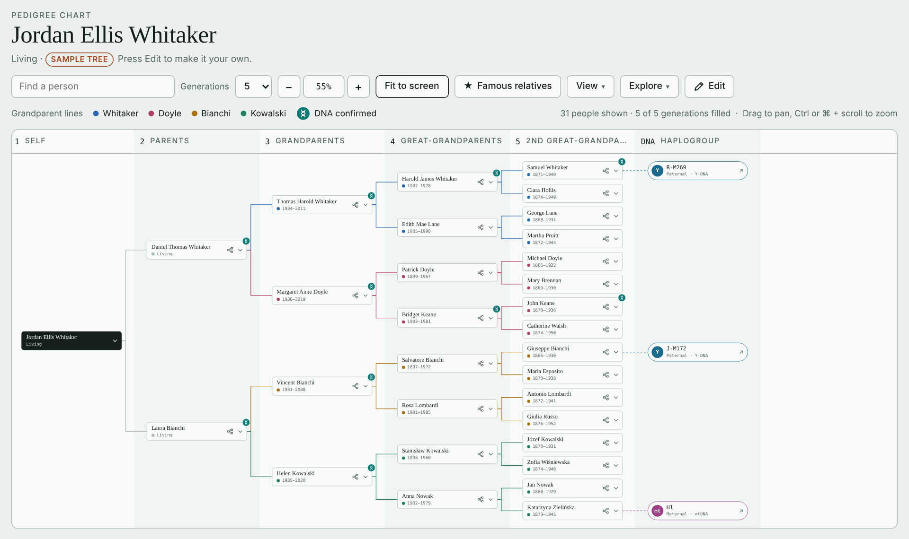
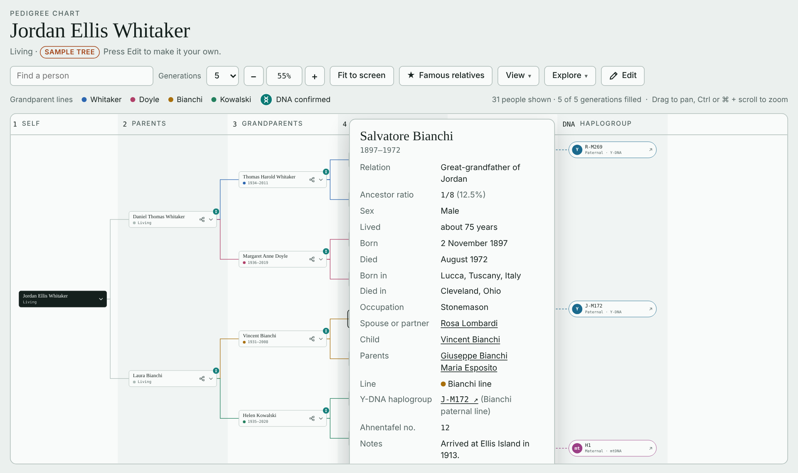
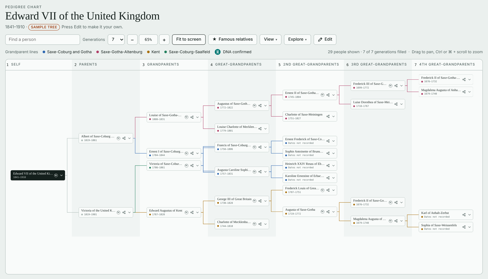
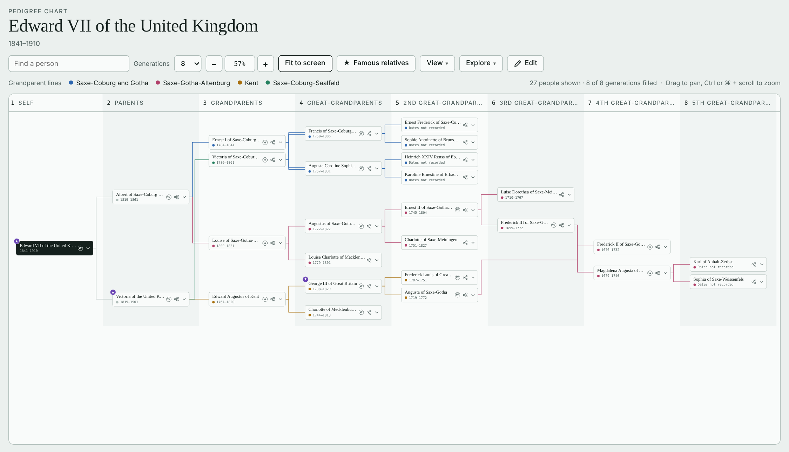

# Pedigree Builder

An editable family-tree pedigree chart that runs entirely in your web browser. Record your ancestors, their dates, places, events and sources, track DNA tests and haplogroups, find famous cousins, and explore your ancestry with a relationship calculator, timeline and places view. Import and export GEDCOM to move your tree to and from Ancestry, FamilySearch, MyHeritage and other programs.

It runs entirely in the browser: there is nothing to install, no account, and no server. Your tree stays on your own computer.



---

## Contents

- [Try it](#try-it)
- [Your first five minutes](#your-first-five-minutes)
- [Features](#features)
- [Using the chart](#using-the-chart)
- [Editing people](#editing-people)
- [Adding ancestors and linking people who appear twice](#adding-ancestors-and-linking-people-who-appear-twice)
- [Example: pedigree collapse in a royal family](#example-pedigree-collapse-in-a-royal-family)
- [Famous relatives](#famous-relatives)
- [DNA tests, confirmations and haplogroups](#dna-tests-confirmations-and-haplogroups)
- [Explore tools](#explore-tools)
- [View options](#view-options)
- [Undo and history](#undo-and-history)
- [Backing up, importing and exporting](#backing-up-importing-and-exporting)
- [Where your data is stored](#where-your-data-is-stored)
- [Privacy](#privacy)
- [Keyboard shortcuts](#keyboard-shortcuts)
- [Browser support](#browser-support)
- [Limitations](#limitations)
- [Troubleshooting](#troubleshooting)
- [File format reference](#file-format-reference)
- [For developers](#for-developers)
- [License](#license)

---

## Try it

There are two ways to use Pedigree Builder:

1. **Online.** Open the project's [GitHub Pages site](https://maxjohnston.github.io/pedigree-builder/).
2. **On your own computer**, offline. Either:
   - **One file:** open the repository's **Releases** page (on the right of the main page), download `pedigree-builder.html` from the latest release, and double-click it. Everything is inside that one file.
   - **The whole project:** click the green **Code** button, then **Download ZIP**. Unzip it and double-click `index.html`. Keep the `css` and `js` folders next to it; the page needs them.

Either way, the page opens with a **sample tree**: an invented family, the Whitakers, five generations deep. It is there so you can see what everything does. None of it is real. A second, historical sample, the ancestry of King Edward VII, shows how ancestors who appear more than once are handled (see [the royal example](#example-pedigree-collapse-in-a-royal-family)). A third, fictional sample, the ancestry of Jon Snow from *A Song of Ice and Fire*, shows the same thing over twenty generations.

> **Important:** the online site and a downloaded copy keep separate trees, because browsers store data per website. Pick one way of using it and stick with it, and export a backup now and then (see [Backing up](#backing-up-importing-and-exporting)).

---

## Your first five minutes

1. **Look around the sample tree.** Each card is a person. Click the **⌄** button on a card to see their details. Generations run from left to right: you on the far left, parents next, then grandparents, and so on.
2. **Start your own tree.** Click **Edit**, then **Backup & reset**, then **Start a blank tree…** and confirm. You now have one person, *Your name*.
3. **Enter yourself.** The form for your own record opens. Fill in your first, middle and last name, tick **Living**, and click **Save changes**.
4. **Add your parents.** While in edit mode, dashed **Add father** and **Add mother** cards appear wherever a parent is missing. Click one, fill in the form, and click **Add father** (or **Add mother**). Keep going back as far as you know.
5. **Click Done** to leave edit mode.
6. **Back it up.** Click **Edit → Backup & reset → Export as .txt file**. Keep that file somewhere safe.

Already have a tree in another program? Export it from there as a **GEDCOM (.ged) file** and import it instead: **Edit → Backup & reset → Import**, choose the file, and pick who the chart should start from.

---

## Features

- **Pedigree chart** from 1 to 45 generations, with zoom, pan and fit-to-screen. Lines are coloured by grandparent line.
- **View anyone's tree:** re-centre the chart on any ancestor to see their ancestry.
- **Rich person records:** first, middle and last name at birth, suffix, married names, sex (for the root person), living or deceased, birth and death dates with day, month and year, uncertain dates (*about*, *before*, *after*, *between*), places, occupation, spouse, children, notes, a Wikipedia link and a photo.
- **Events:** marriage, divorce, baptism, christening, burial, immigration, emigration, naturalization, military service, residence, education, census, religion and other events.
- **Sources** for each person, each tied to the fact it supports (birth, death, parents and so on), shown as numbered citations.
- **Pedigree collapse:** when the same person is your ancestor more than once (for example when cousins married), link them instead of entering them twice.
- **Famous relatives:** record notable cousins and famous ancestors, and draw the line of descent to them on the chart.
- **DNA:** record autosomal, Y-DNA and mtDNA tests and DNA matches. Confirmed people get a DNA badge. Y-DNA and mtDNA haplogroups appear at the end of each direct father or mother line.
- **Find a person:** search by name, place or year and jump to them, including famous relatives.
- **Relationship calculator** for any two people in the tree.
- **Tree report:** completeness by generation and a list of brick walls (ancestors whose parents are not yet recorded).
- **Places and migration:** birthplaces by generation and moves from parent to child.
- **Timeline** of lifespans set against historical events.
- **Undo, redo and an edit history** for the current session.
- **GEDCOM 5.5.1 import and export** for other genealogy programs.
- **Full backup** as a .txt file.
- **Save the chart as a picture** (PNG or SVG).
- **Light and dark themes** that follow your system setting, and a layout that works on phones.

---

## Using the chart



| To… | Do this |
| --- | --- |
| See someone's details | Click **⌄** on their card. Click it again, or press Escape, to close. |
| See the tree from someone else's point of view | Click the small tree icon on their card, or **View this person's tree** in their details. **Back to …'s tree** returns you to the start. |
| Show more or fewer generations | Use the **Generations** menu. The page opens at 5 the first time; after that, this browser remembers the number you last chose. If a tree has fewer generations than that, the chart shows them all and goes back to your number when you load a deeper tree. |
| Zoom | Use **−** and **+**, or hold Ctrl (⌘ on a Mac) and scroll. Click the percentage to return to 100%. |
| Fit the whole chart on screen | Click **Fit to screen**. |
| Move around | Drag the chart with the mouse, or scroll. |
| See where a line continues | A **›** at the right edge of a card means more ancestors are recorded beyond the generations shown. Click it to view that person's tree. |

**What the marks mean**

- **Coloured dots and lines** show which of the four grandparents each ancestor descends from. The legend above the chart names the lines. The colours follow whoever is at the root of the current view. Where several lines run side by side, they are drawn in slightly different shades of their colour (the hue turned a little, lighter or darker) so you can follow each child's line to its parents. A line keeps one shade all the way from the child to the parents, even when it skips generations.
- **Teal DNA badge:** this person is confirmed by a DNA test or match. Hover over it to see how. The *DNA confirmed* key in the legend appears only when a card on the chart has this badge.
- **Rounded Y and mt nodes** after the last known person of a direct father line or mother line show that line's haplogroup. Click one to open its page on FamilyTreeDNA.
- **A line that skips a column** leads to an ancestor who is drawn further back because they are also an ancestor by a longer route (see [pedigree collapse](#example-pedigree-collapse-in-a-royal-family)).
- **Dashed card:** a *repeat* of someone drawn in full in a nearer generation, used only where a line would cross several others. Click it to go to the full card.
- **★ badge:** a notable ancestor (someone whose *Notable for* field is filled in). It is always shown; the Famous relatives panel adds famous cousins and their lines.

**Details panel.** Besides the person's facts, it shows their relationship to the root person, their **ancestor ratio** (the share of the root's ancestry that comes from them; for example 1/8 for a great-grandparent, more if they appear more than once), their grandparent line, haplogroups, DNA confirmations, sources and their number in the tree (see [Ahnentafel numbers](#ahnentafel-numbers)).

---

## Editing people

Click **Edit** to enter edit mode. A bar appears with **Undo**, **Redo**, **History**, **Edit yourself**, **Famous relatives** and **Backup & reset**, and every card gets a ✎ pencil. Click the pencil to open that person's form. Click **Done** when you are finished.

Changes save automatically as soon as you click **Save changes**.

The form is divided into sections:

**Name and dates**
- **First name, Middle name(s), Last name at birth, Suffix** (Jr., Sr., III…). At least a first or last name is required; use *Unknown* if neither is recorded.
- **Married last name(s):** separate several with commas. See [View options](#view-options) to show them on the chart.
- **Sex:** set on your own (root) record. For everyone else it follows their place in the tree: fathers are male and mothers female.
- **Living:** ticking it hides the death fields.
- **Birth date and death date:** choose the precision first (*Exact*, *About*, *Before*, *After* or *Between*), then the day, month and year. Day and month are optional. *Between* asks for a second, later year. A year can have one to four digits. For a year before year 1, type a minus sign or *BC* (`-50` or `50 BC`); it shows as *50 BC*. There is no year 0. The form checks for impossible dates such as 31 April or 29 February in a non-leap year.
- **Born in** and **Died in:** write places from smallest to largest, separated by commas, for example *Xenia, Greene County, Ohio, USA*. The places view groups places by the last parts.

**Life:** occupation, spouse, children and notes.
- **Spouse:** leave empty to use the partner shown in the tree. Fill it in for a spouse who is not in the tree, such as a second marriage.
- **Children:** one name per line. Children who are in the tree are listed automatically, so add only the others (brothers and sisters of your ancestors, for example).

**Events:** click **+ Add event**, choose the kind, and enter a date (*12 May 1890*, *abt 1850*), place and details. Events appear in the details panel and as dots on the timeline.

**Sources:** click **+ Add source**, choose which fact it supports (*Whole record*, *Name*, *Birth*, *Death*, *Parents*, *Marriage*, *Occupation* or *Other events*), give it a title such as *1900 U.S. Census, Xenia, Ohio*, and optionally a link to the record online. Sourced facts get a small citation number in the details panel.

**Photo:** choose an image file. It is shrunk to a small portrait (at most 240 pixels across) so the tree stays light.

**Fame and links:** *Notable for* marks this person as a famous ancestor; *Wikipedia article or web page* adds a link: paste a Wikipedia article's title or address, or the address of any other page (a different wiki, a memorial page and so on). The link's site name is shown in the details panel.

**Haplogroups** and **DNA confirmation:** see [DNA](#dna-tests-confirmations-and-haplogroups).

**Chart layout:** *Show mother above father* swaps the order of this person's parents on the chart. Use it to untangle crossing lines.

**Deleting someone:** click **Delete…** at the bottom of their form. Their own ancestors are deleted with them, unless those ancestors also appear elsewhere in the tree. You are told how many people will go, and you can undo it.

---

## Adding ancestors and linking people who appear twice

In edit mode, a dashed **Add father** or **Add mother** card sits wherever a parent is missing, including one generation beyond what is shown.

Sometimes the person you want to add is **already in the tree**, for example when two of your ancestors were cousins and share grandparents. At the top of the Add form, under **Already in the tree?**, type part of their name, a place or a year, and choose them from the list. The button changes to **Link as father** (or mother).

- They are **drawn once**, with a line to each child. If they belong in the same generation on both routes, the lines are ordinary ones. Lines from full brothers and sisters to their parents always share one vertical line and meet the parents at the same point. A line that skips generations joins the line of a full brother or sister next to the parents; a half-brother's or half-sister's line leads to another parent too, so it is never joined, and the long line gets a lane of its own.
- If the routes have **different lengths**, the person is drawn in the **further generation**, and the line from the nearer child skips the columns in between, running through the gaps between cards. Each skipping line picks the gap where it crosses the fewest other lines, and lines to the same parents join where they can. Where there is room, the person (and everyone behind them) is moved toward the middle of all their children.
- Only if that line would cross **3 or more other lines** does the chart draw the person in the nearer generation instead and put a dashed **repeat card** in each further place. Repeat cards are therefore always in the higher generation. Click one to go to the full card.

The chart makes this choice by itself each time it is drawn. If you would rather never see repeat cards, tick **View → Draw linked ancestors once** (the option appears only when the current view has repeat cards): the ancestor stays in the further generation, and the long line joins its brother's or sister's line next to the parents.

To undo a link later, open the child's form and tick **Unlink** under *Chart layout*.

---

## Example: pedigree collapse in a royal family

**Pedigree collapse** happens when the same person is your ancestor in more than one way, usually because two of your ancestors were related to each other. Everyone's tree collapses eventually (go back far enough and there are more places than people), but royal families show it within a few generations.

Pedigree Builder includes a second sample tree to show how it handles this: the ancestry of **King Edward VII** (1841–1910), whose parents, **Queen Victoria and Prince Albert**, were first cousins. To load it, click **Edit → Backup & reset → Load the royal sample tree…** and confirm. (Your own tree is replaced, so export it first, or use Undo afterwards.) Dates and relationships come from Wikipedia, and most people link to their article.



### Same couple, same generation: drawn once

Queen Victoria's mother, **Victoria of Saxe-Coburg-Saalfeld**, was the sister of Prince Albert's father, **Ernest I**. Their parents, **Francis of Saxe-Coburg-Saalfeld** and **Augusta Reuss of Ebersdorf**, are therefore Edward VII's great-grandparents twice over.

Because they fall in the same generation on both sides, they are drawn **once**, with lines to both of their children. Ernest I and his sister sit side by side, the way brothers and sisters always do on the chart. Open Francis's details and his **ancestor ratio** is 1/4, "reached by 2 routes", instead of the usual 1/8 for a great-grandparent.

In your own tree you make this kind of link from a dashed **Add father** or **Add mother** card: type the person's name under **Already in the tree?** and choose them.

### Same person, different generations: a line that skips a column

**Frederick II of Saxe-Gotha-Altenburg** (1676–1732) and his wife **Magdalena Augusta** are ancestors on both sides, but at different depths:

- through Queen Victoria: George III → his mother **Augusta of Saxe-Gotha** → her parents, Frederick II and Magdalena Augusta (generation 6);
- through Prince Albert: Louise of Saxe-Gotha-Altenburg → Augustus → Ernest II → **Frederick III** → his parents, the same couple (generation 7).

A person can only sit in one column, so the couple is drawn **once, in generation 7**, the further of the two places. Where there is room, parents reached by a line that skips generations are moved toward the middle of all their children, so Frederick II and Magdalena Augusta sit between Frederick III and Augusta of Saxe-Gotha. Augusta's line in generation 5 skips generation 6 and joins the line from Frederick III, so the two children share one route into generation 7. Their own ancestors (Magdalena Augusta's parents, Karl of Anhalt-Zerbst and Sophia of Saxe-Weissenfels) follow in generation 8. Open Frederick II's details: his relation reads *4th and 5th great-grandfather*, and his ancestor ratio is 3/64 (1/32 by one route plus 1/64 by the other).

**When a repeat card is used instead.** If the skipping line would have to cross 3 or more other lines, as happens when the two routes are in distant parts of a large tree, the chart draws the person in the nearer generation and puts a dashed **repeat card** in the further place instead. Repeat cards always sit in the higher generation; click one to go to the full card. This sample does not need any.

The **tree report** (Explore → Tree report) shows the effect on completeness: all 8 great-grandparent places are filled, but by only 6 different people.

### Show mother above father

Normally a person's father is drawn above their mother. When linked ancestors pull lines across the chart, swapping the order can untangle them.

Here, Prince Albert's father, Ernest I, sits next to his sister, Queen Victoria's mother. With Albert's parents in the usual order, Ernest I and his sister are at the top of the chart, and the line from Queen Victoria down at the bottom has to cross all of Albert's branch to reach her mother.



**Show mother above father** is ticked on Prince Albert's record (open his form and look under **Chart layout**). His mother is drawn on top, which moves Ernest I and his sister down next to Queen Victoria's side, and the line no longer crosses. Untick it and save to see the difference, then use Undo to put it back.

It is also ticked on **Ernest II of Saxe-Gotha-Altenburg**, further back. His son Frederick III is drawn below his mother, Luise Dorothea, which brings Frederick III closer to Augusta of Saxe-Gotha, the other child of the couple they share.

### Try it yourself

- **Explore → Relationship calculator:** Prince Albert and Queen Victoria are first cousins, and Edward VII is a 3rd great-grandson of Frederick III.
- **Find a person:** type *Frederick II* to jump to his card in generation 7.
- **★ Famous relatives:** Edward VII, Queen Victoria and George III are marked as notable.

---

## Famous relatives

Click **★ Famous relatives** in the toolbar to show the famous-relatives panel and badges. It lists:

- **Famous ancestors:** anyone whose *Notable for* field is filled in.
- **Famous cousins and other relatives** who share an ancestor with your tree.

Click a relative in the panel to draw their line of descent on the chart. If you are related more than one way, keep clicking to step through the routes. **Hide other lines** keeps only the cards on the selected routes.

**Adding a famous relative:** in edit mode, click **Famous relatives → + Add famous relative**, then:

1. Enter their name, what they are known for, their sex (used for words such as *aunt*, *niece* and *sister*), their birth and death years (an uncertain year can be typed as *c. 1850*, *bef. 1700*, *aft. 1820* or a range such as *1820/1825*), and optionally a link (a Wikipedia article or any web page). Each famous relative needs a different name; add something like *(son of Rhaegar)* to tell two people with the same name apart.
2. Under **How you are related**, choose the **shared ancestor** from your tree.
3. In **Line of descent**, list the generations from that ancestor's child down to the famous person's **parent**, one per line, as *name, born, died*. For example, for a relative who is a grandchild of the shared ancestor:
   ```
   Ruth Whitaker, 1899, 1978
   ```
   Leave it empty if the famous person is the ancestor's own child. Use `…` for a generation whose name is not known. Add `M` or `F` as a fourth item (`Ruth Whitaker, 1899, 1978, F`) to label that person's card correctly when the line is drawn.
4. Tick **half relation** if you descend from only one of the ancestor's partners.
5. Add another route if you are related more than one way.

The relationship (for example *2nd cousin, 3 times removed*) is worked out for you.

---

## DNA tests, confirmations and haplogroups

**DNA confirmation** (in each person's form) records why you believe a link is right. Each entry has a kind and a source (the testing company, or who the match is with):

| Kind | Who it confirms |
| --- | --- |
| **Self test** | Only this person (they took an autosomal test themselves). |
| **Y-DNA test** | Only this person; available for men. |
| **mtDNA test** | Only this person; available for everyone. |
| **DNA match** | This person and everyone in the line from them down to the root (a match with another descendant of theirs). |
| **Y-DNA line** | The root's direct father line, from the root up to this person. Offered only on that line. |
| **mtDNA line** | The root's direct mother line, from the root up to this person. Offered only on that line. |

Confirmed people show a teal DNA badge; hover over it or open their details to see the evidence.

**Haplogroups:** enter a Y-DNA haplogroup on a man, or an mtDNA haplogroup on anyone. It is then listed on everyone up that person's direct father line (Y-DNA) or mother line (mtDNA), and a haplogroup node is drawn after the last known person of that line. The node links to the haplogroup's page on FamilyTreeDNA unless you enter a different link.

**Where the evidence stops:** under each haplogroup, **Evidence reaches up to** is optional. Leave it on *the whole line* and the haplogroup covers everyone up that father or mother line as far as it is recorded. If the DNA only proves the line up to a certain ancestor (for example, the common ancestor of the people who tested), choose that ancestor instead. The node is then drawn after them, people further back are not marked with the haplogroup, and the details panel says *evidence reaches up to …*. *Only this person* limits it to the person you entered it on.

---

## Explore tools

Open **Explore** in the toolbar.

- **Relationship calculator:** choose any two people to see how they are related, with the line through the shared ancestor. Click any name in the path to find it on the chart. It handles ancestors who appear more than once. If no shared ancestor is recorded, it says so, and it recognises partners who are parents of the same child.
- **Tree report:**
  - *At a glance:* how many people are in the tree, and what share have a birth year, a birthplace, a death year, a source, a DNA confirmation or a photo.
  - *Completeness by generation:* how many places in each generation are filled, out of how many possible, and how many different people that is (fewer when someone appears twice).
  - *Brick walls:* everyone whose father or mother is not recorded, closest generations first, with the share of your ancestry missing behind them. **Add father** and **Add mother** buttons open the form straight away.
- **Places and migration:** moves from parent to child, moves within a lifetime (born in one place, died in another), and birthplaces by generation. Group places by **country**, **state or region**, or **town**. Places are grouped by how they are written, so write them consistently.
- **Timeline:** a bar for each person in the current chart view, coloured by grandparent line and set against historical events. Faded bars have uncertain or missing dates. Raise **Generations** to include more people. Living people are hidden unless their birth years are shown (see View options).

**Find a person:** type in the **Find a person** box at the left of the toolbar. Matching names, places and years appear as you type. Choose one to jump to them; the chart adds generations or switches back to the root's tree if needed. Famous relatives are listed too (marked *Famous relative*): choosing one turns on **★ Famous relatives** and draws their line of descent on the chart.

---

## View options

Open **View** in the toolbar:

- **Show birth years of living people:** off by default, so living people show only *Living*. Turn it on to show their birth year.
- **Show photos on cards.**
- **Names on the chart:** birth names, or married names for anyone who has one.
- **Draw linked ancestors once, with long lines instead of repeat cards:** shown only when the current view has dashed repeat cards. When ticked, every linked ancestor is drawn once, in the further generation, and the long line from the nearer child runs straight out from that child, then joins the line of its brother or sister next to the parents. Lines cross more, but nobody appears twice.
- **Save as read-only web page (HTML):** saves the whole app and your tree as one .html file, opening at the generations and person you are viewing. Anyone can open it in a browser, with no install, and look around (zoom, details, famous relatives, Explore), but there is no Edit button and nothing they do is saved. It does not touch the tree saved in their own browser. This works in the single-file version (`pedigree-builder.html` from Releases) and when the page is served from a web server such as GitHub Pages; the split-file version opened by double-clicking `index.html` cannot read its own files, so it explains this instead.
- **Save chart as picture (PNG)** or **(SVG):** saves the chart as currently shown (generations, famous-relative lines and all) to your downloads. Very large charts are too big for PNG; use SVG or lower the generations.

These settings are saved with your tree but are not part of the edit history, so Undo never changes them.

---

## Undo and history

Every change can be undone.

- **Undo** and **Redo** buttons are in the edit bar. Keyboard: Ctrl+Z to undo, Ctrl+Shift+Z or Ctrl+Y to redo (⌘ instead of Ctrl on a Mac).
- **History** lists every change made since the page was opened, newest first, for example *Edited Margaret Doyle: birth 1936 → 1937*. **Restore to before** puts the tree back as it was just before that change, which also undoes everything after it. The restore itself can be undone.
- Imports, *Start a blank tree* and *Load the sample tree* can be undone too.

The history list is cleared when the page is closed or reloaded. Your tree itself is not.

---

## Backing up, importing and exporting

Everything is under **Edit → Backup & reset**.

### Export

- **Export as .txt file:** a complete backup of everything: people, events, sources, photos, famous relatives, haplogroups, DNA notes and view settings. This is the file to keep safe, and the way to move your tree to another browser or computer. If your browser blocks the download, the text is shown with a **Copy this text** button; paste it into a plain-text file.
- **Copy tree data:** copies the same data to the clipboard.
- **Export as GEDCOM (.ged):** for other family-tree programs. See [GEDCOM](#gedcom) below for what it includes.

Files are named like `family-tree-your-name-2026-10-14.txt`.

### Import

- **Choose a file:** a .txt file exported from Pedigree Builder, or a GEDCOM file from another program.
- **Or paste tree data:** paste text from *Copy tree data* and click **Import pasted data…**.

Importing **replaces your current tree**. You are asked to confirm first, and you can undo it afterwards.

### Start again

- **Start a blank tree…** replaces everything with a single person.
- **Load the sample tree…** brings back the Whitaker sample.
- **Load the royal sample tree…** loads the ancestry of King Edward VII, which shows pedigree collapse and parent order (see [the royal example](#example-pedigree-collapse-in-a-royal-family)).
- **Load the Targaryen sample tree…** loads the fictional ancestry of Jon Snow from *A Song of Ice and Fire*, twenty generations deep. Generations of marriages between relatives (brother and sister, uncle and niece, cousins) make many ancestors appear more than once, so it is a good test of lines that skip columns. Rickard Stark is set to *Show mother above father*, which keeps the Stark lines from crossing. The eleven kings of the Seven Kingdoms among Jon's ancestors (Aegon I to Aerys II) and the contested queen Rhaenyra carry the ★ badge, and 84 aunts, uncles, cousins and half-siblings, from Daenerys and the Starks back to Visenya and Orys Baratheon, are recorded as famous relatives. Each person with a ★ or in the famous list links to their page on A Wiki of Ice and Fire. Birth and death years follow A Wiki of Ice and Fire, including its uncertain years (*230/250* for “between”, *bef.* and *aft.*) and years before Aegon's Conquest, shown as BC (Before the Conquest). Fourteen people have portraits.

All of these can be undone.

### GEDCOM

GEDCOM is the standard format for exchanging family trees. Pedigree Builder reads and writes **GEDCOM 5.5.1** in UTF-8.

**Importing a GEDCOM file.** A GEDCOM file usually holds a whole family: brothers, sisters, cousins, in-laws and descendants. Pedigree Builder charts one person's **ancestors**, so after choosing the file you pick **who the chart starts from** (the box suggests someone; type to search for anyone else). Then:

- That person's ancestors are charted, up to 45 generations.
- Brothers, sisters and children of those ancestors are kept as **names** on their parents' records.
- Spouses who are not in the chart are kept in the *Spouse* field.
- Ancestors who appear more than once are linked automatically.
- Names (including married names and prefixes such as *Rev.*), sex, birth and death dates and places, occupations, notes, sources and citations, marriages, divorces and other events are imported.
- Someone with no death record who was born in the last 100 years is marked as living.

**Exporting a GEDCOM file** writes everyone in the tree, their parents' families, children recorded as names, events, notes and sources. Haplogroups, DNA confirmations, the *Notable for* field, Wikipedia links and the living flag are written as custom tags (see [GEDCOM custom tags](#gedcom-custom-tags)); other programs ignore these, but Pedigree Builder reads them back. **Famous relatives and photos are not included in GEDCOM;** use the .txt backup for those.

An example file is in [`examples/sample-tree.ged`](examples/sample-tree.ged).

---

## Where your data is stored

Your tree is saved in your browser's **local storage** after every change. Nothing is sent anywhere.

What that means in practice:

- **It is tied to this browser on this computer.** Another browser, another computer, or a private/incognito window will not see it. Use **Export as .txt file** and **Import** to move it.
- **It is tied to the address you opened the page from.** The GitHub Pages site and a copy on your computer keep separate trees. Copies in different folders may also keep separate trees in some browsers.
- **Clearing your browser's site data, cookies or history for the page deletes the tree.** Some browsers also clear storage for pages you have not visited in a long time.
- **Storage is limited,** usually to about 5 MB per site. Thousands of people fit easily; photos take the most room, which is why they are shrunk. If storage fills up, a message appears in the edit bar: export your tree and remove some photos.

**Export a backup regularly**, and always before clearing browser data or switching computers.

---

## Privacy

- Your tree never leaves your computer unless you export it and share the file.
- The page loads its fonts from Google Fonts, which means your browser contacts Google when the page opens. Offline, or if that is blocked, the page uses your system's fonts instead and works the same.
- Links you click (Wikipedia, FamilyTreeDNA, source records) open those websites in a new tab.
- Living people's birth years are hidden on the chart by default. Exported files contain everything you entered, including living people, so think before you share them. Do not commit your own tree exports to a public repository.

---

## Keyboard shortcuts

| Keys | Action |
| --- | --- |
| Ctrl+Z (⌘Z) | Undo |
| Ctrl+Shift+Z or Ctrl+Y (⌘⇧Z) | Redo |
| Ctrl or ⌘ + mouse wheel | Zoom the chart |
| Escape | Close the open panel, menu or search list |
| ↑ ↓ then Enter | Choose from a search list |
| Tab | Move between buttons and fields |

Undo and redo shortcuts work when you are not typing in a field.

---

## Browser support

Works in current versions of Chrome, Edge, Firefox and Safari, on desktop and mobile. On a phone the chart scrolls within its frame, a person's details appear at the bottom of the screen, and forms fill the screen. Internet Explorer is not supported.

---

## Limitations

- **One tree at a time per browser and address.** Keep separate trees as exported files.
- **Ancestors only.** The chart shows the root person's ancestors. Brothers, sisters, children and other relatives are kept as names, not as full records. Famous relatives are the exception: their lines of descent are drawn on request.
- **Sex** is recorded only for the root person; everyone else's comes from being a father or a mother.
- **No map.** Places are grouped by their text; there is no geographic map.
- **Edit history** lasts only until the page is closed or reloaded.
- **GEDCOM import** keeps only the chosen person's ancestors. Media (photos) and some program-specific details in GEDCOM files are not imported.
- **Storage** is limited by the browser (see above).
- **No sharing or syncing between devices.** Use the export and import files.

---

## Troubleshooting

**The page opens without any styling, or the buttons do nothing.**
You opened `index.html` without its `css` and `js` folders. Download the whole project as a ZIP and keep the folders together, or use the single-file `pedigree-builder.html` from the Releases page.

**My tree disappeared.**
You may be on a different address (the online site instead of your downloaded file, or the other way round), a different browser, or a private window, or your browser's data was cleared. Import your latest .txt backup.

**The download did nothing.**
Check your browser's download bar or settings. Some browsers ask before downloading from a page. For the .txt backup, if the download is blocked, the text appears on screen with a copy button.

**"Could not save: this browser's storage is full or switched off."**
Your browser is blocking or out of local storage. Export the tree immediately, then remove some photos or allow storage for the page. Private windows often have very little storage.

**My GEDCOM import has fewer people than the file.**
Only the chosen person's ancestors are charted. Choose a different starting person if you expected someone else's line. Brothers, sisters and children appear as names in their parents' details.

**Lines cross a lot.**
Open the person whose parents are drawn in the awkward order and tick **Show mother above father** under *Chart layout*.

**The PNG picture failed.**
The chart may be too large. Save it as SVG, or lower **Generations** first.

**The fonts look different from the screenshots.**
Google Fonts could not be loaded (for example offline). Everything still works with your system fonts.

---

## File format reference

### The .txt backup

The backup is plain text: two header lines, a blank line, then the tree as JSON. Pedigree Builder reads the first `{` to the last `}`, so the header can be edited or removed.

```text
Pedigree Builder export · Jordan Ellis Whitaker · 2026-10-14
Import this file on the Backup & reset screen.

{ "v": 1, "people": [ … ], "famous": [ … ], "haplo": [ … ], "dna": [ … ], "photos": { … }, … }
```

Top-level fields:

| Field | Meaning |
| --- | --- |
| `people` | Everyone in the tree (see below). |
| `famous` | Famous relatives: `name`, `title`, `sex` (`M` or `F`), `b`, `d`, `wiki`, and `routes` (each with `anc`, the shared ancestor's number; optional `sp`, the partner; `half`; `note`; and `path`, a list of `[name, born, died, sex]` from the ancestor's child down to the famous person's parent; `sex` is optional). |
| `haplo` | Haplogroups: `type` (`y` or `mt`), `from` (person number), `code`, optional `url`, `line` and `to` (the last person the line reaches). |
| `dna` | DNA confirmations: `type` (`self`, `yt`, `mtt`, `match`, `y` or `mt`), `anchor` (person number) and `src`. |
| `photos` | Photos as small JPEG data URLs, keyed by person number. |
| `showLiving`, `nameView`, `hidePhotos`, `oneCard` | View settings. |
| `sample` | `true` for the built-in sample tree. |

Person fields (only the ones that are filled in are written):

| Field | Meaning |
| --- | --- |
| `n` | The person's number (see Ahnentafel numbers below). |
| `name` | Full name at birth. `fn`, `mn`, `ln`, `sx`: first, middle, last name and suffix. `mln`: married last names. |
| `sex` | `M` or `F`, root person only. |
| `l` | `1` if living. |
| `b`, `bm`, `bdy` | Birth year (negative before year 1, so `-50` is 50 BC), month (1–12) and day. `bq`: `abt`, `bef`, `aft` or `bet`; `b2`: the later year for `bet`. |
| `d`, `dm`, `ddy`, `dq`, `d2` | The same for death. |
| `bp`, `dp` | Birth and death places. |
| `occ`, `spouse`, `notes`, `star`, `wiki` | Occupation, spouse, notes, notable for, and a link: a Wikipedia article title, or the full address (`https://…`) of any page. |
| `children` | Names of children not in the tree. |
| `ev` | Events: `t` (kind), `date` (as written), `y` (year), `pl` (place), `tx` (details). |
| `src` | Sources: `f` (fact supported), `ti` (title), `url`. |
| `fa`, `mo` | Links to a father or mother who is already elsewhere in the tree, in any generation (pedigree collapse). |
| `ref` | Older files only: a stored repeat of person `ref`. It is turned into a link when the file is loaded, because the chart now draws repeat cards by itself. |
| `mf` | `1` draws the mother above the father. |

### Ahnentafel numbers

Every person has a number that says where they sit in the pedigree. The root person is **1**. The father of person *n* is **2n** and the mother is **2n + 1**. So the parents are 2 and 3, the grandparents 4 to 7, the great-grandparents 8 to 15, and so on. Even numbers are men and odd numbers (other than 1) are women. The number is shown at the bottom of each person's details.

### GEDCOM custom tags

| Tag | Level | Meaning |
| --- | --- | --- |
| `_LIVING Y` | 1 | The person is living. |
| `_STAR` | 1 | Notable for. |
| `_WIKI` | 1 | Wikipedia article title, or the full address of another page. |
| `_YDNA`, `_MTDNA` | 1 | Haplogroup starting from this person, with optional `2 _URL` and `2 _TO @I…@`. |
| `_DNA` | 1 | DNA confirmation kind (`self`, `yt`, `mtt`, `match`, `y`, `mt`), with `2 _SRC` for the source. |

Deceased people with no death details are written with `1 DEAT Y`.

---

## For developers

Pedigree Builder is plain HTML, CSS and JavaScript, with no framework, no dependencies (apart from optional Google Fonts) and no build step needed to run it.

### Project layout

```text
index.html              The page: toolbar, chart area and panels
css/styles.css          All styles, including light and dark themes
js/sample-data.js       The three sample trees: the invented Whitakers, Edward VII's ancestry and Jon Snow's fictional ancestry
js/core.js              Shared state (STATE) and helpers: rebuild(), names, dates, grandparent lines
js/chart.js             Chart layout and drawing, zoom and pan, famous-relative lines, details panel, navigation
js/editing.js           Edit mode: side sheet, person form, linking, deleting, famous-relative forms, backup screen
js/storage.js           Saving to localStorage, undo/redo/history, view settings, menus, keyboard shortcuts
js/files-gedcom.js      File downloads and GEDCOM import/export
js/picture.js           Saving the chart as PNG or SVG
js/explore.js           Find, relationship calculator, tree report, places, timeline
js/main.js              Start-up (loaded last)
tools/build-single-file.py   Joins everything into dist/pedigree-builder.html
docs/                   Screenshots for this README
examples/sample-tree.ged     The sample family as GEDCOM, for testing import
```

The scripts are ordinary `<script>` files, not ES modules, so the page still opens by double-clicking `index.html` (browsers block modules on pages opened from disk). They share one global scope and **must load in the order listed in `index.html`**: each file can use anything defined in the files before it, and functions in later files may only be called from inside functions, not at load time. `main.js` starts the app once everything is defined.

### How it works

- **Data:** the tree lives in one object, `STATE`, saved to `localStorage` under the key `pedigree-builder-tree`. The chosen number of generations is kept separately under `pedigree-builder-generations` (it is a view setting, not part of the tree). Every edit goes through `commit()`, which records an undo snapshot, rebuilds the lookup tables (`rebuild()`), redraws the chart (`render()`) and saves (`queueSave()`).
- **Layout:** `render()` lays the pedigree out in generation columns, packs branches vertically, groups siblings who share parents, and assigns connector lanes to reduce crossings.
- **People** are numbered by [Ahnentafel number](#ahnentafel-numbers); `fa(n)` and `mo(n)` give a person's father and mother, taking linked parents into account.

### Running it locally

Double-click `index.html`, or serve the folder with any static server, for example `python3 -m http.server` and open `http://localhost:8000`.

### The single-file build

`tools/build-single-file.py` inlines the stylesheet and scripts into `dist/pedigree-builder.html`, a single file people can download and use offline. It needs only Python 3:

```sh
python3 tools/build-single-file.py
```

You don't normally need to run it yourself: when a release is published on GitHub, the workflow in `.github/workflows/single-file.yml` builds the file and attaches it to the release. `dist/` is not committed.

### Deploying

GitHub Pages serves `index.html` from the repository root with no configuration.

Bug reports and pull requests are welcome. Please do not include real people's personal data in issues or example files.

---

## License

Released under the MIT License. See [LICENSE](LICENSE).
